<a href="https://lucas-nonato.netlify.app/">
<picture>
  <source media="(prefers-color-scheme: dark)" srcset="./assets/header-dark.svg">
  
</picture></a>

 

  <a href="https://lucas-nonato.netlify.app/"><picture><source media="(prefers-color-scheme: dark)" srcset="./assets/link-portfolio-dark.svg"></picture></a>&nbsp;
  <a href="https://www.linkedin.com/in/lucas-nonato1"><picture><source media="(prefers-color-scheme: dark)" srcset="./assets/link-linkedin-dark.svg"></picture></a>&nbsp;
  <a href="mailto:lucas.nonato1@hotmail.com"><picture><source media="(prefers-color-scheme: dark)" srcset="./assets/link-email-dark.svg"></picture></a>

 

  I design and build AI products end to end, from the first UX sketch to LLMs, agents and RAG running in production.

  
    NOW · building <b>Aura, Vivo's AI platform</b> · running <a href="https://www.ervassagradas.com/">Ervas Sagradas</a> · evolving my <a href="https://lucas-nonato.netlify.app/">portfolio</a>
  

 

<picture>
  <source media="(prefers-color-scheme: dark)" srcset="./assets/h-ai-dark.svg">
  
</picture>

<picture>
  <source media="(prefers-color-scheme: dark)" srcset="./assets/ai-dark.svg">
  
</picture>

 

<picture>
  <source media="(prefers-color-scheme: dark)" srcset="./assets/h-work-dark.svg">
  
</picture>

  <a href="https://www.ervassagradas.com/"><picture><source media="(prefers-color-scheme: dark)" srcset="./assets/project-ervas-dark.svg"></picture></a>&nbsp;&nbsp;&nbsp;<a href="https://lucas-nonato.netlify.app/"><picture><source media="(prefers-color-scheme: dark)" srcset="./assets/project-portfolio-dark.svg"></picture></a>

 

<picture>
  <source media="(prefers-color-scheme: dark)" srcset="./assets/h-career-dark.svg">
  
</picture>

<picture>
  <source media="(prefers-color-scheme: dark)" srcset="./assets/timeline-dark.svg">
  
</picture>

 

<picture>
  <source media="(prefers-color-scheme: dark)" srcset="./assets/h-stack-dark.svg">
  
</picture>

  Seven years across UX, front-end, back-end and AI, grouped by where each tool does its job.

 

<picture>
  <source media="(prefers-color-scheme: dark)" srcset="./assets/s-ai-dark.svg">
  
</picture>

  <picture><source media="(prefers-color-scheme: dark)" srcset="./assets/chips/python-dark.svg"></picture>
  <picture><source media="(prefers-color-scheme: dark)" srcset="./assets/chips/llm-apis-dark.svg">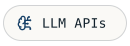</picture>
  <picture><source media="(prefers-color-scheme: dark)" srcset="./assets/chips/llm-sdks-dark.svg"></picture>
  <picture><source media="(prefers-color-scheme: dark)" srcset="./assets/chips/gemini-dark.svg">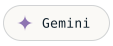</picture>
  <picture><source media="(prefers-color-scheme: dark)" srcset="./assets/chips/agents-dark.svg"></picture>
  <picture><source media="(prefers-color-scheme: dark)" srcset="./assets/chips/tool-calling-dark.svg"></picture>
  <picture><source media="(prefers-color-scheme: dark)" srcset="./assets/chips/agent-orchestration-dark.svg"></picture>
  <picture><source media="(prefers-color-scheme: dark)" srcset="./assets/chips/crewai-dark.svg">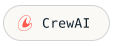</picture>
  <picture><source media="(prefers-color-scheme: dark)" srcset="./assets/chips/opencode-dark.svg">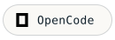</picture>
  <picture><source media="(prefers-color-scheme: dark)" srcset="./assets/chips/rag-dark.svg"></picture>
  <picture><source media="(prefers-color-scheme: dark)" srcset="./assets/chips/embeddings-dark.svg"></picture>
  <picture><source media="(prefers-color-scheme: dark)" srcset="./assets/chips/vector-stores-dark.svg"></picture>
  <picture><source media="(prefers-color-scheme: dark)" srcset="./assets/chips/evals-dark.svg">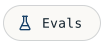</picture>
  <picture><source media="(prefers-color-scheme: dark)" srcset="./assets/chips/mlops-dark.svg">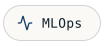</picture>
  <picture><source media="(prefers-color-scheme: dark)" srcset="./assets/chips/whatsapp-dark.svg"></picture>
  <picture><source media="(prefers-color-scheme: dark)" srcset="./assets/chips/rcs-dark.svg"></picture>
  <picture><source media="(prefers-color-scheme: dark)" srcset="./assets/chips/webviews-dark.svg"></picture>

 

<picture>
  <source media="(prefers-color-scheme: dark)" srcset="./assets/s-media-dark.svg">
  
</picture>

  <picture><source media="(prefers-color-scheme: dark)" srcset="./assets/chips/fal-ai-dark.svg">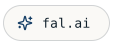</picture>
  <picture><source media="(prefers-color-scheme: dark)" srcset="./assets/chips/flux-dark.svg"></picture>
  <picture><source media="(prefers-color-scheme: dark)" srcset="./assets/chips/image-to-video-dark.svg"></picture>
  <picture><source media="(prefers-color-scheme: dark)" srcset="./assets/chips/elevenlabs-dark.svg">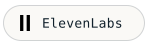</picture>
  <picture><source media="(prefers-color-scheme: dark)" srcset="./assets/chips/text-to-speech-dark.svg"></picture>
  <picture><source media="(prefers-color-scheme: dark)" srcset="./assets/chips/ffmpeg-dark.svg"></picture>
  <picture><source media="(prefers-color-scheme: dark)" srcset="./assets/chips/timed-captions-dark.svg"></picture>
  <picture><source media="(prefers-color-scheme: dark)" srcset="./assets/chips/sqlite-fts5-dark.svg"></picture>

 

<picture>
  <source media="(prefers-color-scheme: dark)" srcset="./assets/s-front-dark.svg">
  
</picture>

  <picture>
    <source media="(prefers-color-scheme: dark)" srcset="https://skillicons.dev/icons?theme=dark&perline=13&i=ts%2Cjs%2Creact%2Cnextjs%2Cangular%2Credux%2Cmaterialui%2Ctailwind%2Csass%2Cstyledcomponents%2Cvite%2Chtml%2Ccss">
    
  </picture>

  <picture><source media="(prefers-color-scheme: dark)" srcset="./assets/chips/rxjs-dark.svg"></picture>
  <picture><source media="(prefers-color-scheme: dark)" srcset="./assets/chips/angular-material-dark.svg">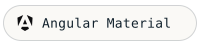</picture>
  <picture><source media="(prefers-color-scheme: dark)" srcset="./assets/chips/framer-motion-dark.svg"></picture>
  <picture><source media="(prefers-color-scheme: dark)" srcset="./assets/chips/design-systems-dark.svg"></picture>
  <picture><source media="(prefers-color-scheme: dark)" srcset="./assets/chips/wcag-2-2-aa-dark.svg"></picture>
  <picture><source media="(prefers-color-scheme: dark)" srcset="./assets/chips/pwa-dark.svg">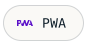</picture>
  <picture><source media="(prefers-color-scheme: dark)" srcset="./assets/chips/i18n-dark.svg">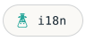</picture>

 

<picture>
  <source media="(prefers-color-scheme: dark)" srcset="./assets/s-back-dark.svg">
  
</picture>

  <picture>
    <source media="(prefers-color-scheme: dark)" srcset="https://skillicons.dev/icons?theme=dark&perline=13&i=nodejs%2Cpy%2Cnestjs%2Cexpress%2Cjava%2Cspring%2Ccs%2Cdotnet%2Cgraphql%2Cpostgres%2Cmongodb%2Cmysql%2Csqlite">
    
  </picture>

  <picture><source media="(prefers-color-scheme: dark)" srcset="./assets/chips/rest-apis-dark.svg">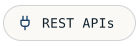</picture>
  <picture><source media="(prefers-color-scheme: dark)" srcset="./assets/chips/asp-net-mvc-dark.svg"></picture>
  <picture><source media="(prefers-color-scheme: dark)" srcset="./assets/chips/typeorm-dark.svg">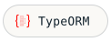</picture>
  <picture><source media="(prefers-color-scheme: dark)" srcset="./assets/chips/sequelize-dark.svg">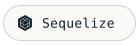</picture>
  <picture><source media="(prefers-color-scheme: dark)" srcset="./assets/chips/nhibernate-dark.svg"></picture>
  <picture><source media="(prefers-color-scheme: dark)" srcset="./assets/chips/dapper-dark.svg">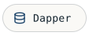</picture>
  <picture><source media="(prefers-color-scheme: dark)" srcset="./assets/chips/strapi-dark.svg">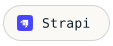</picture>
  <picture><source media="(prefers-color-scheme: dark)" srcset="./assets/chips/oauth2-dark.svg"></picture>
  <picture><source media="(prefers-color-scheme: dark)" srcset="./assets/chips/mtls-dark.svg"></picture>
  <picture><source media="(prefers-color-scheme: dark)" srcset="./assets/chips/clean-architecture-dark.svg"></picture>
  <picture><source media="(prefers-color-scheme: dark)" srcset="./assets/chips/c4-model-dark.svg">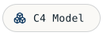</picture>

 

<picture>
  <source media="(prefers-color-scheme: dark)" srcset="./assets/s-delivery-dark.svg">
  
</picture>

  <picture>
    <source media="(prefers-color-scheme: dark)" srcset="https://skillicons.dev/icons?theme=dark&perline=13&i=jest%2Cvitest%2Ccypress%2Caws%2Cdocker%2Cgithubactions%2Cvercel%2Cnetlify%2Clinux%2Cgit">
    
  </picture>

  <picture><source media="(prefers-color-scheme: dark)" srcset="./assets/chips/tdd-dark.svg"></picture>
  <picture><source media="(prefers-color-scheme: dark)" srcset="./assets/chips/testing-library-dark.svg"></picture>
  <picture><source media="(prefers-color-scheme: dark)" srcset="./assets/chips/axe-core-dark.svg"></picture>
  <picture><source media="(prefers-color-scheme: dark)" srcset="./assets/chips/ci-cd-dark.svg">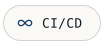</picture>
  <picture><source media="(prefers-color-scheme: dark)" srcset="./assets/chips/conventional-commits-dark.svg"></picture>
  <picture><source media="(prefers-color-scheme: dark)" srcset="./assets/chips/code-review-dark.svg"></picture>

 

<picture>
  <source media="(prefers-color-scheme: dark)" srcset="./assets/s-product-dark.svg">
  
</picture>

  <picture><source media="(prefers-color-scheme: dark)" srcset="./assets/chips/figma-dark.svg"></picture>
  <picture><source media="(prefers-color-scheme: dark)" srcset="./assets/chips/ux-research-dark.svg"></picture>
  <picture><source media="(prefers-color-scheme: dark)" srcset="./assets/chips/prototyping-dark.svg"></picture>
  <picture><source media="(prefers-color-scheme: dark)" srcset="./assets/chips/sketch-dark.svg"></picture>
  <picture><source media="(prefers-color-scheme: dark)" srcset="./assets/chips/user-testing-dark.svg"></picture>
  <picture><source media="(prefers-color-scheme: dark)" srcset="./assets/chips/scrum-dark.svg"></picture>
  <picture><source media="(prefers-color-scheme: dark)" srcset="./assets/chips/kanban-dark.svg"></picture>
  <picture><source media="(prefers-color-scheme: dark)" srcset="./assets/chips/product-management-dark.svg"></picture>

 

<picture>
  <source media="(prefers-color-scheme: dark)" srcset="./assets/h-github-dark.svg">
  
</picture>

<picture>
  <source media="(prefers-color-scheme: dark)" srcset="https://raw.githubusercontent.com/Scriblet/scriblet/output/snake-dark.svg">
  
</picture>

 

<a href="https://lucas-nonato.netlify.app/">
<picture>
  <source media="(prefers-color-scheme: dark)" srcset="./assets/footer-dark.svg">
  
</picture></a>

