<a href="https://lucas-nonato.netlify.app/">
<picture>
  <source media="(prefers-color-scheme: dark)" srcset="./assets/header-dark.svg">
  
</picture></a>

 

  <a href="https://lucas-nonato.netlify.app/"><picture><source media="(prefers-color-scheme: dark)" srcset="./assets/link-portfolio-dark.svg"></picture></a>&nbsp;
  <a href="https://www.linkedin.com/in/lucas-nonato1"><picture><source media="(prefers-color-scheme: dark)" srcset="./assets/link-linkedin-dark.svg"></picture></a>&nbsp;
  <a href="mailto:lucas.nonato1@hotmail.com"><picture><source media="(prefers-color-scheme: dark)" srcset="./assets/link-email-dark.svg"></picture></a>

 

  I design and build AI products end to end, from the first UX sketch to LLMs, agents and RAG running in production.

  
    NOW · building <b>Aura, Vivo's AI platform</b> · running <a href="https://www.ervassagradas.com/">Ervas Sagradas</a> · evolving my <a href="https://lucas-nonato.netlify.app/">portfolio</a>
  

 

<picture>
  <source media="(prefers-color-scheme: dark)" srcset="./assets/h-ai-dark.svg">
  
</picture>

<picture>
  <source media="(prefers-color-scheme: dark)" srcset="./assets/ai-dark.svg">
  
</picture>

 

<picture>
  <source media="(prefers-color-scheme: dark)" srcset="./assets/h-work-dark.svg">
  
</picture>

  <a href="https://www.ervassagradas.com/"><picture><source media="(prefers-color-scheme: dark)" srcset="./assets/project-ervas-dark.svg"></picture></a>&nbsp;&nbsp;&nbsp;<a href="https://lucas-nonato.netlify.app/"><picture><source media="(prefers-color-scheme: dark)" srcset="./assets/project-portfolio-dark.svg"></picture></a>

 

<picture>
  <source media="(prefers-color-scheme: dark)" srcset="./assets/h-career-dark.svg">
  
</picture>

<picture>
  <source media="(prefers-color-scheme: dark)" srcset="./assets/timeline-dark.svg">
  
</picture>

 

<picture>
  <source media="(prefers-color-scheme: dark)" srcset="./assets/h-stack-dark.svg">
  
</picture>

  Seven years across UX, front-end, back-end and AI, grouped by where each tool does its job.

 

<picture>
  <source media="(prefers-color-scheme: dark)" srcset="./assets/s-ai-dark.svg">
  
</picture>

  <code>Python</code> <code>LLM APIs</code> <code>LLM SDKs</code> <code>Gemini</code> <code>Agents</code> <code>Tool calling</code> <code>Multi-agent orchestration</code> <code>CrewAI</code> <code>OpenCode</code> <code>RAG</code> <code>Embeddings</code> <code>Vector stores</code> <code>Evals</code> <code>MLOps</code> <code>WhatsApp</code> <code>RCS</code> <code>Webviews</code>

 

<picture>
  <source media="(prefers-color-scheme: dark)" srcset="./assets/s-media-dark.svg">
  
</picture>

  <code>fal.ai</code> <code>Flux</code> <code>Image to video</code> <code>ElevenLabs</code> <code>Text to speech</code> <code>FFmpeg</code> <code>Timed captions</code> <code>SQLite FTS5</code>

 

<picture>
  <source media="(prefers-color-scheme: dark)" srcset="./assets/s-front-dark.svg">
  
</picture>

  <picture>
    <source media="(prefers-color-scheme: dark)" srcset="https://skillicons.dev/icons?theme=dark&perline=13&i=ts%2Cjs%2Creact%2Cnextjs%2Cangular%2Credux%2Cmaterialui%2Ctailwind%2Csass%2Cstyledcomponents%2Cvite%2Chtml%2Ccss">
    
  </picture>

  <code>RxJS</code> <code>Angular Material</code> <code>Framer Motion</code> <code>Design systems</code> <code>WCAG 2.2 AA</code> <code>PWA</code> <code>i18n</code>

 

<picture>
  <source media="(prefers-color-scheme: dark)" srcset="./assets/s-back-dark.svg">
  
</picture>

  <picture>
    <source media="(prefers-color-scheme: dark)" srcset="https://skillicons.dev/icons?theme=dark&perline=13&i=nodejs%2Cpy%2Cnestjs%2Cexpress%2Cjava%2Cspring%2Ccs%2Cdotnet%2Cgraphql%2Cpostgres%2Cmongodb%2Cmysql%2Csqlite">
    
  </picture>

  <code>REST APIs</code> <code>ASP.NET MVC</code> <code>TypeORM</code> <code>Sequelize</code> <code>NHibernate</code> <code>Dapper</code> <code>Strapi</code> <code>OAuth2</code> <code>mTLS</code> <code>Clean Architecture</code> <code>C4 Model</code>

 

<picture>
  <source media="(prefers-color-scheme: dark)" srcset="./assets/s-delivery-dark.svg">
  
</picture>

  <picture>
    <source media="(prefers-color-scheme: dark)" srcset="https://skillicons.dev/icons?theme=dark&perline=13&i=jest%2Cvitest%2Ccypress%2Caws%2Cdocker%2Cgithubactions%2Cvercel%2Cnetlify%2Clinux%2Cgit">
    
  </picture>

  <code>TDD</code> <code>Testing Library</code> <code>axe-core</code> <code>CI/CD</code> <code>Conventional Commits</code> <code>Code review</code>

 

<picture>
  <source media="(prefers-color-scheme: dark)" srcset="./assets/s-product-dark.svg">
  
</picture>

  <code>Figma</code> <code>UX research</code> <code>Prototyping</code> <code>Sketch</code> <code>User testing</code> <code>Scrum</code> <code>Kanban</code> <code>Product management</code>

 

<picture>
  <source media="(prefers-color-scheme: dark)" srcset="./assets/h-github-dark.svg">
  
</picture>

<picture>
  <source media="(prefers-color-scheme: dark)" srcset="https://raw.githubusercontent.com/Scriblet/scriblet/output/snake-dark.svg">
  
</picture>

 

<a href="https://lucas-nonato.netlify.app/">
<picture>
  <source media="(prefers-color-scheme: dark)" srcset="./assets/footer-dark.svg">
  
</picture></a>

