<a href="https://lucas-nonato.netlify.app/">
  <picture>
    <source media="(prefers-color-scheme: dark)" srcset="./assets/header-dark.svg">
    
  </picture>
</a>

  <picture>
    <source media="(prefers-color-scheme: dark)" srcset="https://readme-typing-svg.demolab.com?font=Martian+Mono&weight=500&size=17&duration=3200&pause=1400&center=true&vCenter=true&width=820&height=44&lines=LLMs%2C+agents+and+RAG+built+to+survive+production;Accessible+React+%2B+TypeScript+interfaces+(WCAG+2.2+AA);Node.js+APIs+with+tests%2C+CI+and+clear+architecture;Folha%2C+f%C3%A9+e+fundamento.&color=8FCA7F">
    
  </picture>

  
  
  

## About

I'm an **AI Consultant and Software Engineer** from São Paulo with 7+ years shipping products end to end, from UX research and design systems to APIs, cloud and CI. Today I work on **Aura, Vivo's AI platform**, integrating LLMs, agents and APIs into architectures that scale. Before that: Porto Seguro, Thoughtworks (where I helped make products 100% WCAG compliant), ArcoTech and Finger, the career consultancy I founded and designed as a UX lead.

<table>
  <tr>
    <td width="50%" valign="top">

**Right now**

- Building AI features in production at **Vivo**: LLMs, agents, RAG and MLOps
- Running **[Ervas Sagradas](https://www.ervassagradas.com/)**, a digital encyclopedia of sacred herbs
- Evolving my **[open source portfolio](https://github.com/Scriblet/portfolio-2025)** and its Mata e mar design system

</td>
    <td width="50%" valign="top">

**Ask me about**

- Taking an AI idea from prototype to production
- React, TypeScript and Node.js architecture
- Accessibility (WCAG 2.2 AA), design systems and UX

</td>
  </tr>
</table>

## How I work with AI

| Layer | Belief | In practice |
| :-- | :-- | :-- |
| **01 · Product and usage** | AI only matters when it changes someone's work. | Map where AI pays off, assisted code review and docs, prototype to validate before investing |
| **02 · Model integration** | A good model is one that survives production. | LLMs via API in TypeScript/Node, embeddings and search, response validation, retry and fallback |
| **03 · Context and RAG** | Good answers start with good context. | Chunking and indexing, vector stores, structured prompts and relevance evaluation |
| **04 · Agents and orchestration** | An agent is software with tools, not a chatbot with a personality. | Tool calling, memory and state, multi-step flows with human review, limits and permissions |
| **05 · Operation and governance** | What isn't observed can't be trusted. | Prompt traces, evals and regression, cost and latency, privacy, OAuth2/mTLS and versioning |

## Featured work

  <a href="https://www.ervassagradas.com/">
    <picture>
      <source media="(prefers-color-scheme: dark)" srcset="./assets/project-ervas-dark.svg">
      
    </picture>
  </a><a href="https://github.com/Scriblet/portfolio-2025">
    <picture>
      <source media="(prefers-color-scheme: dark)" srcset="./assets/project-portfolio-dark.svg">
      
    </picture>
  </a>

## Career

<picture>
  <source media="(prefers-color-scheme: dark)" srcset="./assets/timeline-dark.svg">
  
</picture>

## Stack

<table>
  <tr>
    <td align="center" width="25%"><b>Front-end</b></td>
    <td align="center" width="25%"><b>Back-end and data</b></td>
    <td align="center" width="25%"><b>Quality</b></td>
    <td align="center" width="25%"><b>Cloud and delivery</b></td>
  </tr>
  <tr>
    <td align="center"><picture><source media="(prefers-color-scheme: dark)" srcset="https://skillicons.dev/icons?theme=dark&i=ts%2Creact%2Cnextjs%2Cangular%2Cvite%2Ctailwind%2Cmaterialui%2Csass&perline=4"></picture></td>
    <td align="center"><picture><source media="(prefers-color-scheme: dark)" srcset="https://skillicons.dev/icons?theme=dark&i=nodejs%2Cpy%2Cgraphql%2Cpostgres%2Cmongodb%2Ccs%2Cdotnet&perline=4"></picture></td>
    <td align="center"><picture><source media="(prefers-color-scheme: dark)" srcset="https://skillicons.dev/icons?theme=dark&i=jest%2Cvitest%2Ccypress%2Cfigma&perline=4"></picture></td>
    <td align="center"><picture><source media="(prefers-color-scheme: dark)" srcset="https://skillicons.dev/icons?theme=dark&i=aws%2Cdocker%2Cgithubactions%2Cvercel%2Cnetlify%2Clinux%2Cgit&perline=4"></picture></td>
  </tr>
</table>

<b>AI:</b> LLM APIs · agents and tool calling · RAG · embeddings and vector stores · evals · MLOps

## On GitHub

  <picture>
    <source media="(prefers-color-scheme: dark)" srcset="https://streak-stats.demolab.com/?user=scriblet&disable_animations=true&border_radius=24&card_width=495&background=08120C&border=203D22&stroke=203D22&ring=8FCA7F&fire=E0A85A&currStreakNum=EBEFE6&sideNums=EBEFE6&currStreakLabel=8FCA7F&sideLabels=B9C4B3&dates=8F9D8D">
    
  </picture>

<picture>
  <source media="(prefers-color-scheme: dark)" srcset="https://github-readme-activity-graph.vercel.app/graph?username=scriblet&area=true&hide_border=true&radius=24&height=300&custom_title=Contributions%20in%20the%20last%2031%20days&bg_color=08120c&color=b9c4b3&title_color=ebefe6&line=8fca7f&point=e0a85a&area_color=8fca7f">
  
</picture>

<picture>
  <source media="(prefers-color-scheme: dark)" srcset="https://raw.githubusercontent.com/Scriblet/scriblet/output/snake-dark.svg">
  
</picture>

<a href="https://lucas-nonato.netlify.app/">
  <picture>
    <source media="(prefers-color-scheme: dark)" srcset="./assets/footer-dark.svg">
    
  </picture>
</a>

