<a href="https://lucas-nonato.netlify.app/">
<picture>
  <source media="(prefers-color-scheme: dark)" srcset="./assets/header-dark.svg">
  
</picture></a>

 

  <a href="https://lucas-nonato.netlify.app/"><picture><source media="(prefers-color-scheme: dark)" srcset="./assets/link-portfolio-dark.svg"></picture></a>&nbsp;
  <a href="https://www.linkedin.com/in/lucas-nonato1"><picture><source media="(prefers-color-scheme: dark)" srcset="./assets/link-linkedin-dark.svg"></picture></a>&nbsp;
  <a href="mailto:lucas.nonato1@hotmail.com"><picture><source media="(prefers-color-scheme: dark)" srcset="./assets/link-email-dark.svg"></picture></a>

 

  I design and build AI products end to end, from the first UX sketch to LLMs, agents and RAG running in production.

  
    NOW · building <b>Aura, Vivo's AI platform</b> · running <a href="https://www.ervassagradas.com/">Ervas Sagradas</a> · evolving my <a href="https://lucas-nonato.netlify.app/">portfolio</a>
  

 

<picture>
  <source media="(prefers-color-scheme: dark)" srcset="./assets/h-ai-dark.svg">
  
</picture>

<picture>
  <source media="(prefers-color-scheme: dark)" srcset="./assets/ai-dark.svg">
  
</picture>

 

<picture>
  <source media="(prefers-color-scheme: dark)" srcset="./assets/h-work-dark.svg">
  
</picture>

  <a href="https://www.ervassagradas.com/"><picture><source media="(prefers-color-scheme: dark)" srcset="./assets/project-ervas-dark.svg"></picture></a>&nbsp;&nbsp;&nbsp;<a href="https://lucas-nonato.netlify.app/"><picture><source media="(prefers-color-scheme: dark)" srcset="./assets/project-portfolio-dark.svg"></picture></a>

 

<picture>
  <source media="(prefers-color-scheme: dark)" srcset="./assets/h-career-dark.svg">
  
</picture>

<picture>
  <source media="(prefers-color-scheme: dark)" srcset="./assets/timeline-dark.svg">
  
</picture>

 

<picture>
  <source media="(prefers-color-scheme: dark)" srcset="./assets/h-stack-dark.svg">
  
</picture>

  <picture>
    <source media="(prefers-color-scheme: dark)" srcset="https://skillicons.dev/icons?theme=dark&perline=13&i=ts%2Creact%2Cnextjs%2Cangular%2Cvite%2Ctailwind%2Cmaterialui%2Csass%2Cnodejs%2Cpy%2Cgraphql%2Cpostgres%2Cmongodb%2Ccs%2Cdotnet%2Cjest%2Cvitest%2Ccypress%2Cfigma%2Caws%2Cdocker%2Cgithubactions%2Cvercel%2Cnetlify%2Clinux%2Cgit">
    
  </picture>

Plus LLM APIs · agents and tool calling · RAG · embeddings and vector stores · evals · MLOps

 

<picture>
  <source media="(prefers-color-scheme: dark)" srcset="./assets/h-github-dark.svg">
  
</picture>

<picture>
  <source media="(prefers-color-scheme: dark)" srcset="https://raw.githubusercontent.com/Scriblet/scriblet/output/snake-dark.svg">
  
</picture>

 

<a href="https://lucas-nonato.netlify.app/">
<picture>
  <source media="(prefers-color-scheme: dark)" srcset="./assets/footer-dark.svg">
  
</picture></a>

